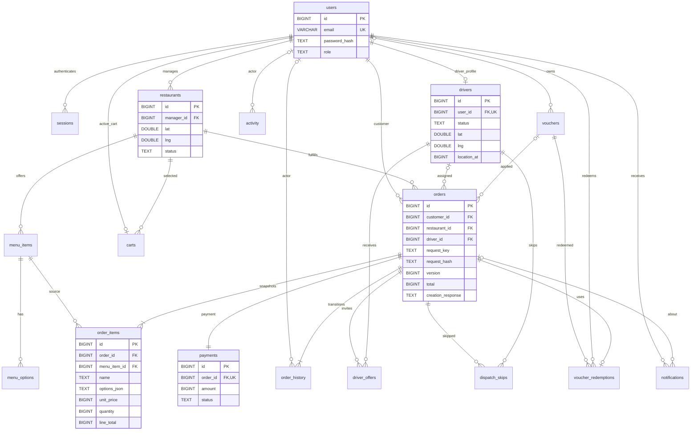

# Thiết kế CSDL GoMeal cho M3

CSDL triển khai bằng MySQL 8 (InnoDB), adapter bất đồng bộ `mysql2/promise` trên Node.js >=24. Đã chuyển service/controller M2, fixture và test sang async/await cùng lúc theo M3-TASKS.md. Server M2 dùng schema MySQL qua cấu hình DB_NAME; MemoryStore tiếp tục làm test double. Đặc tả này đối chiếu `backend/docs/M3-CONTRACT.md`, báo cáo mục 7.4, 8.2, 9, 14.7 và các record thực tế của service/fixture M2.

## Quan hệ thực thể

Bội số `1..n` dòng món/lịch sử và một payment diễn tả đơn đã tạo thành công qua service. FK không tự buộc bảng cha phải có con: transaction CreateOrder chịu trách nhiệm ghi đủ các thành phần trước commit. Không ghi trực tiếp đơn bằng SQL ngoài migration/seed được kiểm soát.

## Từ điển dữ liệu

DDL đầy đủ, `NOT NULL`, mặc định, `CHECK`, FK và index nằm tại `../sql/schema.sql`; đây là nguồn chính xác để tạo schema. Mọi bảng nghiệp vụ đều có `id BIGINT UNSIGNED AUTO_INCREMENT PRIMARY KEY`; tất cả dùng InnoDB và utf8mb4_0900_ai_ci. Dấu `?` dưới đây chỉ cột cho phép NULL. Thời gian là Unix epoch milliseconds, không phụ thuộc múi giờ khi lưu; giao diện hiển thị Asia/Bangkok.

| Bảng logic / vật lý | Cột ngoài id | Ý nghĩa và ràng buộc chính |
|---|---|---|
| users | email, name, password_hash, phone?, role | Email UNIQUE theo collation utf8mb4_0900_ai_ci; Auth chuẩn hóa lowercase; scrypt có salt; phone nếu có phải 10 chữ số. CUSTOMER/MANAGER/DRIVER/ADMIN. |
| sessions | token_hash, user_id, expires_at | SHA-256 token, UNIQUE; FK users; phiên hết hạn không được xác thực. Không lưu bearer token nguyên dạng. |
| restaurants | manager_id, name, address, cuisine, lat, lng, status | FK users; lat/lng bắt buộc, trong [-90,90]/[-180,180]; ACTIVE/INACTIVE. Không UNIQUE manager_id. |
| menu_items | restaurant_id, name, category_id, description, price, available | FK restaurants; category_id mặc định main, description mặc định rỗng; giá nguyên 0..1 tỷ; available 0/1. |
| menu_options | menu_item_id, name, surcharge, available | FK món; phụ phí nguyên 0..1 tỷ; available 0/1. Option độc lập, không có nhóm bắt buộc trong MVP. |
| drivers | user_id, status, locked, lat?, lng?, location_at?, updated_at | UNIQUE user_id; OFFLINE/AVAILABLE/BUSY; locked 0/1; vị trí và thời điểm cùng NULL hoặc cùng có dữ liệu. |
| orders | customer_id, restaurant_id, driver_id?, status, subtotal, delivery_fee, total, delivery_address, contact_phone, payment_method, request_key, request_hash, creation_response?, cancel_reason?, retry_at?, version, created_at, updated_at | FK khách/nhà hàng/tài xế; UNIQUE(customer_id,request_key); version mặc định 1; snapshot phản hồi tạo đơn dạng JSON; tổng = tiền món + phí giao. |
| order_items | order_id, menu_item_id, name, options_json, unit_price, quantity, line_total | FK orders/menu_items; snapshot tên món, mảng tên/giá option; quantity 1..99; line_total=unit_price*quantity. |
| payments | order_id, amount, status, transaction_id? | UNIQUE order_id, transaction_id; FK orders; PENDING/SUCCESS/FAILED/VOIDED/REFUNDED. COD có transaction_id NULL. |
| order_history | order_id, status, actor_id?, at | FK orders/users; actor NULL dành cho tiến trình; đọc theo id để giữ thứ tự ghi khi trùng timestamp. |
| driver_offers | order_id, driver_id, status, distance_km, expires_at, created_at | FK orders/drivers; PENDING/ACCEPTED/DECLINED/EXPIRED/REVOKED; expires_at>created_at; cột sinh STORED và UNIQUE cho đơn và tài xế khi PENDING. |
| dispatch_skips | order_id, driver_id | FK orders/drivers; UNIQUE(order_id,driver_id); xóa khi hết kỳ retry 30 giây. |
| carts | customer_id, restaurant_id, items_json | FK users/restaurants; UNIQUE customer_id; JSON array gồm menuItemId, quantity, selectedOptionIds. |
| activity | actor_id?, text, at | FK users; nhật ký nghiệp vụ/quản trị, cùng transaction với thay đổi; khác log kỹ thuật của HTTP. |
| vouchers (002) | code, description, kind, percent?, amount?, max_discount?, min_subtotal, customer_id?, expires_at?, active, created_at | code UNIQUE (chữ hoa, số, -, _); SHIPPING/ORDER; đúng một trong percent (1–100) hoặc amount; customer_id NULL = mọi khách. |
| voucher_redemptions (002) | voucher_id, customer_id, order_id | UNIQUE(voucher_id, customer_id): mỗi khách dùng một lần, hai đơn đồng thời thì một đơn bị CONFLICT; UNIQUE order_id; xóa khi hủy đơn để trả voucher. |
| notifications (002) | user_id, order_id?, kind, title, body, created_at, read_at? | FK users/orders; index (user_id, id) cho đọc 30 thông báo mới nhất; ghi cùng transaction nghiệp vụ. |
| settings (002) | name, value | name UNIQUE; hiện có fuel_price (đ/lít) để tính phí giao. |

Migration 002 còn thêm `restaurants.phone`, `menu_items.ingredients`, `menu_items.image_url` (chỉ đường dẫn `/media/...`, file ảnh nằm ở backend), và trên `orders`: `discount`, `voucher_id`, `delivery_lat`, `delivery_lng`, `distance_km`; CHECK tổng tiền đổi thành `total = subtotal + delivery_fee - discount`. Tên CHECK cũ do MySQL tự đặt nên migration tìm theo nội dung trong information_schema rồi xóa bằng câu PREPARE.

`schema_migrations(name,checksum,applied_at)` là bảng hạ tầng. restaurants.location là POINT NOT NULL SRID 4326 có SPATIAL INDEX; BEFORE INSERT/UPDATE trigger đồng bộ từ lat/lng. Tài xế dùng B-tree (status,locked,location_at), phù hợp vị trí NULL khi OFFLINE.

## Khóa và tính toàn vẹn

- Khóa email, customer/request_key và các khóa đơn/tài xế đều được CSDL thực thi trên mọi kết nối; không dựa vào kiểm tra trước trong RAM.
- `uq_offer_order_pending` đặt UNIQUE trên cột sinh pending_order_id=CASE WHEN status=PENDING THEN order_id ELSE NULL END: mỗi đơn tối đa một offer PENDING. pending_driver_id tương tự cho tài xế. MySQL cho phép nhiều NULL trong UNIQUE. Điều kiện mạnh hơn “còn hạn”: offer hết hạn vẫn giữ khóa tới khi worker đóng EXPIRED; không dùng thời gian hiện tại trong predicate index.
- `uq_driver_active_order` đặt UNIQUE trên active_driver_id sinh từ driver_id chỉ khi status thuộc DRIVER_ASSIGNED/PICKED_UP/DELIVERING; trạng thái khác sinh NULL. Đơn kết thúc giữ driver_id để tra lịch sử. Trạng thái đã gán/giao xong phải có driver_id.
- Tiền là BIGINT VND, không DOUBLE; adapter cũng từ chối số tiền không nguyên trước khi driver có thể ép kiểu. Tổng/dòng/amount tối đa Number.MAX_SAFE_INTEGER (9.007.199.254.740.991) để Node không mất độ chính xác. CHECK xác nhận phương trình total và line_total. Service Billing tính tổng các dòng và kiểm tra nhà hàng, món/option, giá, vai trò và quyền sở hữu.
- CAS chạy một câu `UPDATE ... WHERE id <=> ? AND version <=> ?`; không khớp trả DomainError(CONFLICT). Service tăng version khi đổi trạng thái; rollback bao gồm payment, driver, history và activity.
- Mọi quan hệ dùng FOREIGN KEY tường minh do InnoDB thực thi; không dùng cú pháp REFERENCES nội dòng không có tác dụng ràng buộc trên MySQL. Không cascade xóa lịch sử: món và nhà hàng ngừng hoạt động bằng cờ, không xóa bản ghi được đơn tham chiếu. Dữ liệu snapshot không đổi khi sửa menu.
- Retry đúng customer/request_key và cùng request_hash trả creation_response đã lưu; payload khác trả CONFLICT. Transaction khóa record đọc bằng SELECT FOR UPDATE; UNIQUE là hàng rào cuối. Nếu insert cùng key đụng UNIQUE hoặc transaction deadlock/timeout, adapter rollback rồi thử lại callback tối đa 4 lần; lần sau đọc đơn đã commit để trả replay.

## Transaction và ánh xạ hợp đồng

`rows/find/insert/update/remove/transaction/inTransaction/user/restaurant/driver/order/offer/history/activity/orderView/close` có đủ trong `src/mysql-store.js`. Tên logic ánh xạ thẳng sang bảng cùng tên. Cột sinh và cột location không lộ vào record logic. SQL dùng bind parameters và whitelist bảng/cột. JSON được driver trả dưới dạng chuỗi để giữ hợp đồng items_json/options_json/creation_response của M2.

Mọi hàm I/O trả Promise. M2 đã await truy vấn, transaction, DTO và controller; map bất đồng bộ dùng Promise.all. HTTP envelope không đổi. Transaction lấy một connection từ pool, đặt READ COMMITTED rồi BEGIN/COMMIT/ROLLBACK. AsyncLocalStorage gắn connection vào từng luồng async; inTransaction là getter theo ngữ cảnh, không dùng một cờ chung cho tất cả request. Đọc rows/find trong transaction dùng SELECT FOR UPDATE. Callback lồng dùng SAVEPOINT.

UNIQUE 1062, deadlock 1213, lock timeout 1205 và lock NOWAIT 3572 ánh xạ DomainError(CONFLICT); CHECK/FK/NULL/range/kiểu dữ liệu ánh xạ VALIDATION. Controller chỉ xử lý DomainError. Retry tối đa 4 lần chỉ dành cho transaction ngoài gặp UNIQUE/deadlock/timeout; các lỗi nghiệp vụ không retry. Callback chỉ chứa thao tác CSDL và thanh toán mô phỏng; không đặt tác dụng phụ bên ngoài như gửi email/thanh toán thật vào callback có retry.

Migration dùng GET_LOCK theo tên database để ngăn hai server cùng áp DDL, lưu SHA-256 để phát hiện sửa migration đã áp. MySQL DDL tự commit, không thể hứa rollback toàn bộ DDL: bảng CREATE IF NOT EXISTS và trigger được kiểm tra tồn tại cho phép chạy tiếp sau lần áp dở. Chỉ ghi schema_migrations sau khi hoàn tất. Thêm migration 002_*.sql khi mở rộng; giữ schema.sql đã áp nguyên vẹn. Quyền CREATE/ALTER/INDEX/TRIGGER cần cấp cho tài khoản migration; khi binary log bật, DBA cần xử lý quyền tạo trigger hoặc log_bin_trust_function_creators trước khi chạy.

`orderView` dùng chung với MemoryStore, giữ DTO và history theo id. Ba truy vấn mở rộng có fallback MemoryStore: restaurantPage, nearestDriver, customerOrders. Phân trang nhà hàng/lịch sử đơn bằng SQL LIMIT/OFFSET. Dashboard quản trị/quản lý vẫn theo service M2, không thuộc ba API đọc NFR-01. MemoryStore có queue transaction async để tiếp tục chạy test; không dùng kết quả RAM thay cho bằng chứng InnoDB.

## Index vị trí và truy vấn

FR-02: restaurants.location POINT NOT NULL SRID 4326 có SPATIAL INDEX. WKT POINT dùng vĩ độ trước, kinh độ sau theo trục mặc định EPSG 4326; -180 được chuẩn hóa thành 180 khi tạo geometry. Trigger duy trì location cùng lat/lng; test đọc ST_Latitude/ST_Longitude để tránh đảo trục.

restaurantPage lấy hộp bao quanh vòng 5 km bằng MBRIntersects, sau đó dùng ST_Distance_Sphere với bán kính Trái Đất 6371000 m để khớp Haversine M2, lọc distance<=5 km và sắp distance/id, LIMIT 20. Nếu hộp chạm cực hoặc đường đổi ngày, dùng khoảng lat an toàn rồi lọc khoảng cách chính xác. Collation utf8mb4_0900_ai_ci hỗ trợ tìm tên không phân biệt hoa thường và dấu; đây là hành vi MySQL đã chốt trong M3-TASKS.md.

Mục 7.4: nearestDriver dùng index (status,locked,location_at), loại vị trí cũ quá 120 giây hoặc ở tương lai, tài xế có offer PENDING và cặp đã skip bằng NOT EXISTS/index. Sau đó tính ST_Distance_Sphere và sắp distanceKm, updated_at cũ hơn, id nhỏ hơn. Không áp giới hạn 5 km của nhà hàng cho bài toán tài xế. Không spatial-index cột tài xế nullable; khi mở rộng lớn hơn có thể tách bảng vị trí tài xế online.

Index B-tree bổ sung cho customer/created_at, restaurant/id, driver/updated_at, hàng đợi status/driver_id/created_at, payment/order_id, dòng/lịch sử/order_id, offer/status/expires_at và khóa skip. Test so kết quả với Haversine, kiểm tọa độ và EXPLAIN cho SPATIAL INDEX. Optimizer có thể chọn index khác trên bộ demo nhỏ.

## Đối chiếu mục 14.7

| Mô hình báo cáo | Thiết kế triển khai |
|---|---|
| Customer | users role CUSTOMER; dùng customer_id ở orders/carts. |
| Restaurant, MenuItem, MenuOption | restaurants/menu_items/menu_options, quan hệ 1-n. |
| Order, MoneyVND | orders với tiền nguyên, version, khách/nhà hàng bắt buộc, driver tùy chọn. |
| OrderItem, optionSnapshot | order_items với tên/giá/options_json đã chốt. |
| Driver, DriverOffer | drivers/driver_offers; lịch sử nhiều đơn, generated-column UNIQUE giới hạn đơn đang giao và lời mời. |
| OrderStatusHistory | order_history, actor nullable, thứ tự id tăng. |
| Báo cáo không chốt số nhà hàng/quản lý | manager_id không UNIQUE, hỗ trợ nhiều nhà hàng/quản lý. |
| Báo cáo không chốt số Payment/đơn hoặc giỏ/khách | MVP chọn UNIQUE payments.order_id và carts.customer_id để khớp code/DTO M2, không suy diễn đây là yêu cầu gốc của mục 14.7. |

Đánh giá, ảnh, giờ mở cửa, ETA và nhóm option bắt buộc không thuộc bản schema MVP đã chọn. Xem `UI-DATA-DECISIONS.md` để bàn giao M1/M2.
